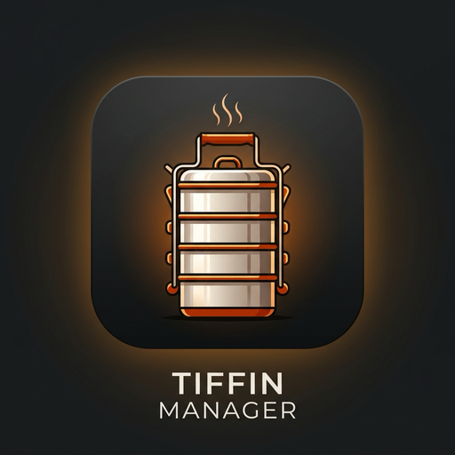
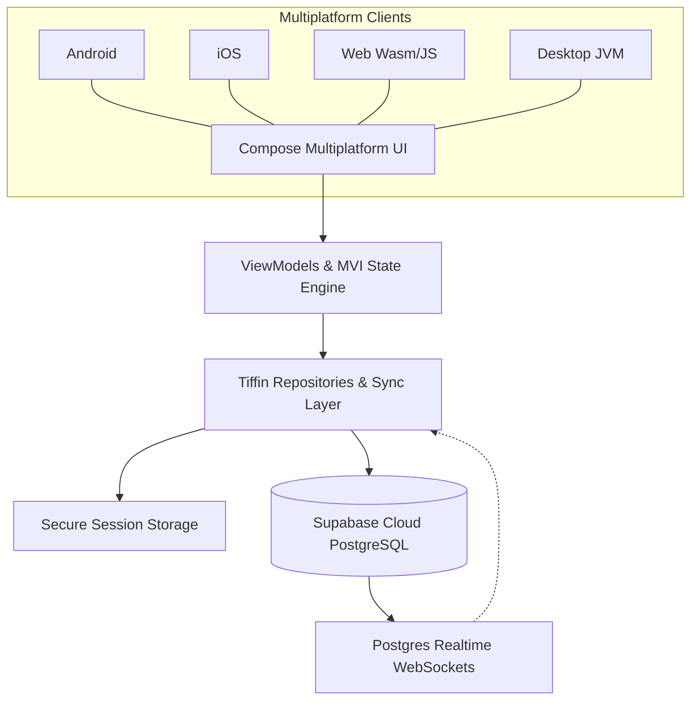

# Tiffin Management 🍱🚀

<p align="center">
  
</p>

<p align="center">
  <b>Enterprise Cross-Platform Meal Subscription, Kitchen Logistics & Smart Delivery Management System</b>
</p>

<p align="center">
  
  
  
  
  
</p>

---

## 🌟 Overview

**Tiffin Management** is a full-stack, enterprise-grade logistics and recurring subscription management suite built with **Compose Multiplatform** targeting **Android, iOS, Web (Wasm/JS), and Desktop (JVM)**. Engineered specifically for commercial kitchens, tiffin delivery startups, and catering businesses, it unifies customer self-service portals, kitchen production consoles, and real-time delivery rider fleets into a single synchronized ecosystem.

Backed by **Supabase PostgreSQL** with automated ledger accounting, real-time dispatch clustering, and doorstep drop-proof verification, it eliminates missed deliveries, food wastage, and manual ledger reconciliations.

---

## ✨ Key Features & Portals

### 1. 👥 Customer Self-Service Portal
- **Smart Subscription Calendar**: Pause, resume, or switch between lunch/dinner meal plans with instant cutoff recalculation.
- **Dynamic Weekly Menus**: Browse daily rotating nutritional menus with allergen alerts and spice preference controls.
- **Live Delivery Tracking**: Real-time rider route progression, estimated arrival countdowns, and instant push notifications.
- **Billing & Digital Ledger**: UPI payment gateway integration, transaction history, statement downloads, and wallet auto-recharge.

### 2. 🍳 Kitchen Production & Batching Console
- **Automated Forecast Engine**: Real-time batch counts grouped by dietary categories (Jain, High-Protein, Standard, Vegan) computed directly from active subscription states.
- **Packaging & Labeling Pipeline**: QR-coded tiffin box tag generator for error-free assembly line dispatch.
- **Raw Material & Inventory Tracker**: Automated ingredients requirement forecasting based on scheduled meal calendars.

### 3. 🛵 Delivery Rider Dispatch & Custody Ledger
- **Optimized Sequence Stops**: Turn-by-turn clustered delivery routes minimizing fuel consumption and transit time.
- **Doorstep Drop Proof**: Photo verification and signature capture upon delivery completion.
- **Box Inventory Custody**: Real-time tracking of insulated tiffin containers across customers and riders to prevent container loss.
- **Shift & Earnings Ledger**: Transparent shift calculation, payout logs, and instant incident reporting (e.g. customer unavailable).

### 4. 📊 Admin ERP & Analytics Hub
- Multi-branch administration with granular role-based access control.
- Revenue analytics, subscriber churn prediction, recurring expense management, and automated monthly P&L summaries.

---

## 🏗️ Architecture & Technology Stack



### Tech Stack Details:
| Category | Stack |
|---|---|
| **Language** | Kotlin 2.3.0 |
| **Cross-Platform UI** | JetBrains Compose Multiplatform 1.9.3 |
| **Backend & Database** | Supabase (PostgreSQL 15+, Row-Level Security, Auth, Realtime) |
| **Architecture** | Clean Architecture + MVI (StateFlow, Unidirectional Data Flow) |
| **Concurrency** | Kotlin Coroutines 1.10.2 |
| **State & Session** | Multiplatform SessionStorage (Android SharedPreferences, iOS Keychain, Web LocalStorage) |

---

## 📂 Project Structure

```text
TiffinManagement/
├── composeApp/
│   ├── src/
│   │   ├── commonMain/
│   │   │   ├── kotlin/com/creativeblisslabs/tiffinmanagement/
│   │   │   │   ├── ui/screens/          # 60+ responsive screens
│   │   │   │   │   ├── customer/        # Customer tracking, menu, plans
│   │   │   │   │   ├── rider/           # Route list, box custody, drop proof
│   │   │   │   │   └── admin/           # Ledgers, branches, forecasting
│   │   │   │   ├── data/                # Supabase models, repositories, storage
│   │   │   │   └── theme/               # Material 3 typography & styling
│   │   ├── androidMain/                 # Android Jetpack Compose wrappers
│   │   ├── iosMain/                     # iOS ViewController entry points
│   │   ├── webMain/                     # Wasm/JS web app loaders
│   │   └── jvmMain/                     # Desktop window managers
├── supabase_schema.sql                  # Comprehensive PostgreSQL schema with RLS & functions
├── playstore/                           # High-res graphics (512x512 icon, feature banner)
└── gradle/                              # Versions catalog & configuration
```

---

## 🚀 Building & Running

```bash
# Android APK
./gradlew :composeApp:assembleDebug

# Desktop Application (JVM)
./gradlew :composeApp:run

# Web Application (Wasm/JS)
./gradlew :composeApp:wasmJsBrowserDevelopmentRun
```

---


---

## 📱 App Screenshots

<p align="center">
  <table>
    <tr>
      <td align="center" width="25%">
        <br />
        <b>1. Main Screen</b>
      </td>
      <td align="center" width="25%">
        <br />
        <b>2. Core Experience</b>
      </td>
      <td align="center" width="25%">
        <br />
        <b>3. Interactive Mode</b>
      </td>
      <td align="center" width="25%">
        <br />
        <b>4. Advanced Features</b>
      </td>
    </tr>
    <tr>
      <td align="center" width="25%">
        <br />
        <b>5. Workflow / Details</b>
      </td>
      <td align="center" width="25%">
        <br />
        <b>6. Studio Console</b>
      </td>
      <td align="center" width="25%">
        <br />
        <b>7. Settings & Config</b>
      </td>
      <td align="center" width="25%">
        <br />
        <b>8. Dark & Light Theme</b>
      </td>
    </tr>
  </table>
</p>

---

## 📄 License
Designed and developed by **CreativeBliss Labs**. All rights reserved.
